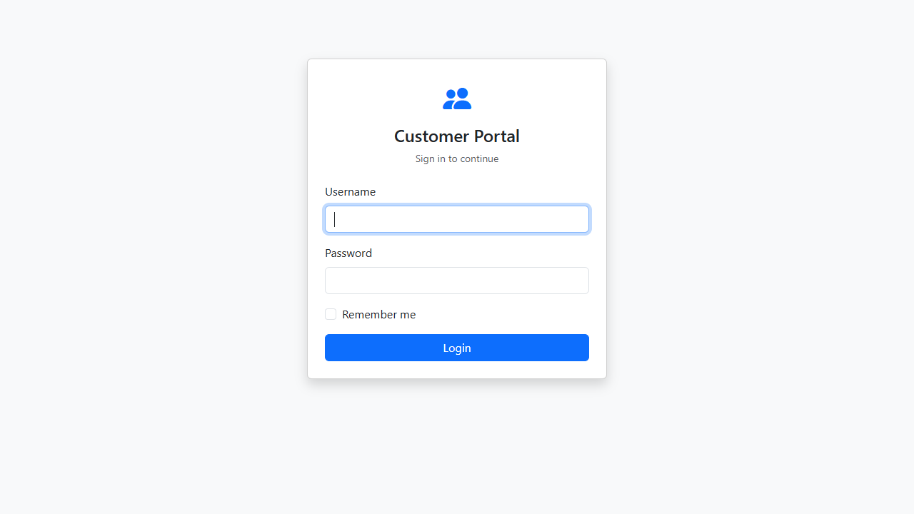
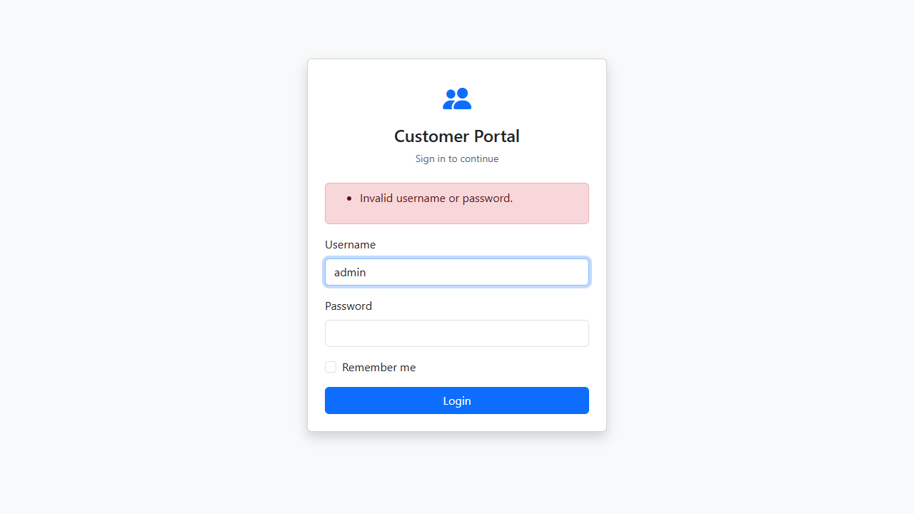
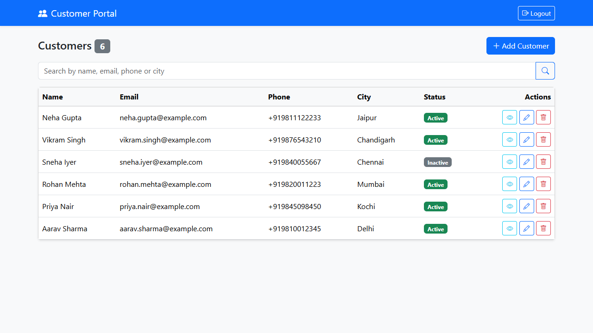
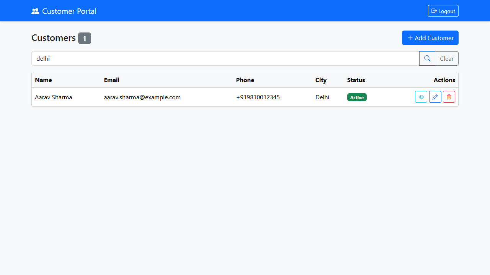
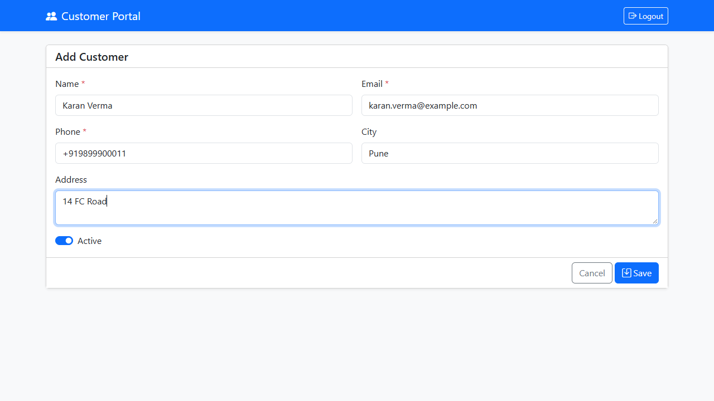
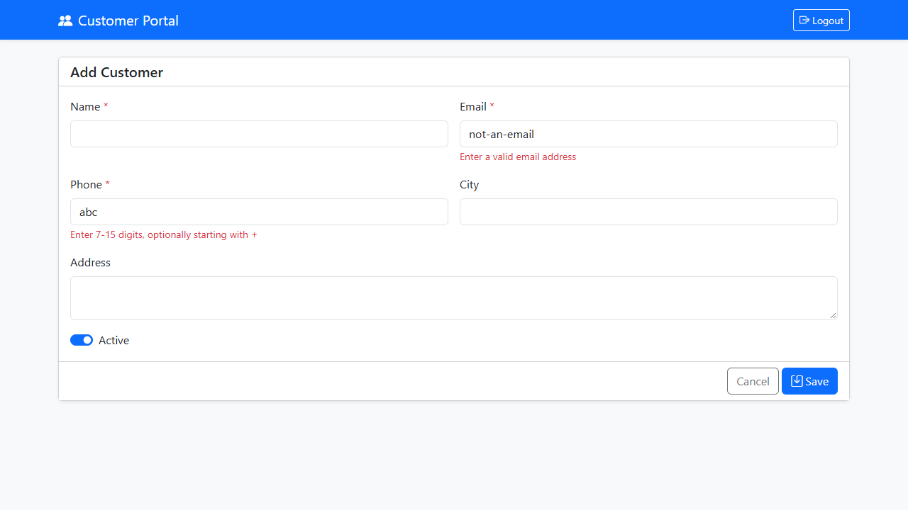
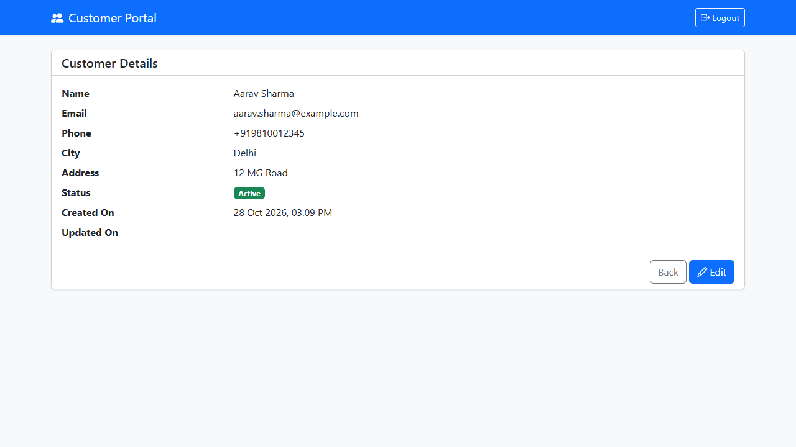
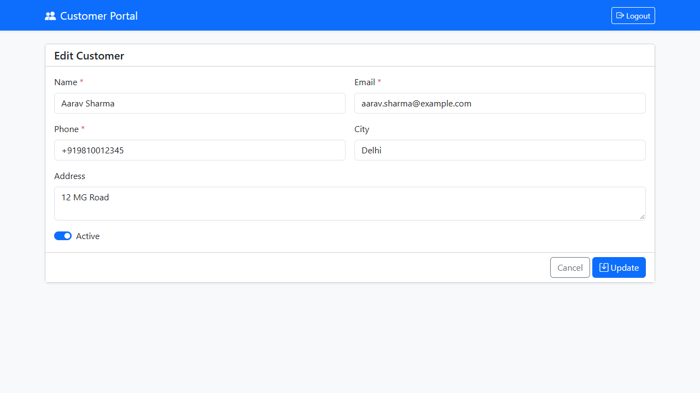
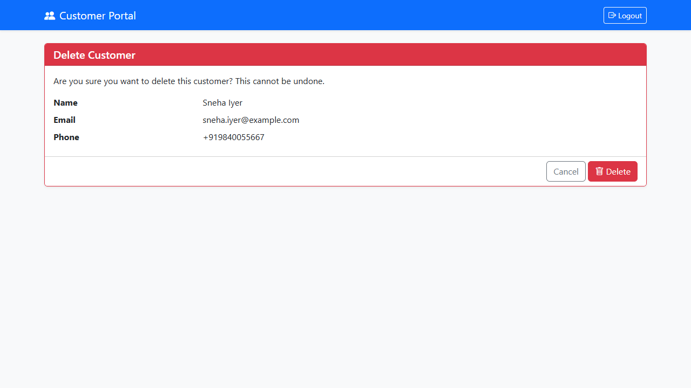

# Customer Portal

A web application with a login page and a Customer Master (create, view, edit, update, delete), built with ASP.NET Core MVC, C# and SQL Server.

## Tech Stack

| Layer | Technology |
|---|---|
| Framework | ASP.NET Core MVC (.NET 8) |
| Language | C# |
| Database | SQL Server (LocalDB / SQL Server) |
| Data access | Entity Framework Core 8 |
| Authentication | Cookie authentication |
| UI | Razor views, Bootstrap 5, Bootstrap Icons |
| Validation | DataAnnotations (server) + jQuery Validation (client) |

## Features

- Login with validation and an error message for wrong credentials
- Customer list with search (name, email, phone, city) and paging
- Add, view, edit and delete customers
- Delete asks for confirmation
- Server-side and client-side validation, including a unique email check
- Customer pages are protected: users who are not logged in are sent to the login page

## How It Works

1. The user opens the app and is redirected to the login page.
2. The login form posts to `AccountController`, which looks up the username in the `Users` table and compares the password.
3. On success a login cookie is created and the user is sent to the customer list.
4. `CustomersController` (marked `[Authorize]`) reads and writes the `Customers` table through `AppDbContext`.
5. Each action passes a model to a Razor view, which renders the page.
6. Invalid input is checked in the browser first, then again on the server; errors are shown next to the fields.

## MVC Structure

| Part | Role | Files |
|---|---|---|
| Model | Data, validation rules and database access | `Models/Customer.cs`, `User.cs`, `LoginViewModel.cs`, `AppDbContext.cs` |
| View | The pages the user sees | `Views/Account`, `Views/Customers`, `Views/Shared` |
| Controller | Handles requests and connects models to views | `Controllers/AccountController.cs`, `CustomersController.cs`, `HomeController.cs` |

Request flow: Browser → Controller → Model / Database → View → Browser

## Folder Structure

```
MY_PROJECT                            Solution folder
├── README.md
├── MY_PROJECT.sln                    Solution file
├── global.json                       .NET SDK version
├── docs
│   └── screenshots                   Images used in this README
└── MY_PROJECT                        Web project
    ├── Controllers
    │   ├── AccountController.cs      Login / Logout
    │   ├── CustomersController.cs    Customer CRUD, search, paging
    │   └── HomeController.cs         Error page
    ├── Models
    │   ├── AppDbContext.cs           Entity Framework database context
    │   ├── Customer.cs               Customer entity + validation
    │   ├── User.cs                   User entity
    │   ├── LoginViewModel.cs         Login form model
    │   └── ErrorViewModel.cs
    ├── Views
    │   ├── Account
    │   │   └── Login.cshtml
    │   ├── Customers
    │   │   ├── Index.cshtml          List, search, paging
    │   │   ├── Create.cshtml
    │   │   ├── Edit.cshtml
    │   │   ├── Details.cshtml
    │   │   ├── Delete.cshtml
    │   │   └── _Form.cshtml          Fields shared by Create and Edit
    │   ├── Shared
    │   │   ├── _Layout.cshtml
    │   │   ├── _ValidationScriptsPartial.cshtml
    │   │   └── Error.cshtml
    │   ├── _ViewImports.cshtml
    │   └── _ViewStart.cshtml
    ├── Database
    │   └── CreateDatabase.sql        Creates the database, tables and admin user
    ├── Properties
    │   └── launchSettings.json       Port settings
    ├── wwwroot/css/site.css
    ├── appsettings.json              Connection string
    ├── MY_PROJECT.csproj
    └── Program.cs                    App startup
```

## Database

Database name: `CustomerPortalMvcDb`

### Users

| Column | Type | Constraints |
|---|---|---|
| Id | INT | Primary key, identity |
| Username | NVARCHAR(50) | Required, unique |
| FullName | NVARCHAR(100) | Required |
| Password | NVARCHAR(100) | Required |

### Customers

| Column | Type | Constraints |
|---|---|---|
| Id | INT | Primary key, identity |
| Name | NVARCHAR(100) | Required |
| Email | NVARCHAR(150) | Required, unique |
| Phone | NVARCHAR(20) | Required |
| Address | NVARCHAR(250) | Optional |
| City | NVARCHAR(100) | Optional |
| IsActive | BIT | Required, default 1 |
| CreatedOn | DATETIME2 | Required, default current UTC time |
| UpdatedOn | DATETIME2 | Optional, set when a customer is edited |

## Setup

1. Install the .NET 8 SDK and SQL Server (or use LocalDB).
2. Open `MY_PROJECT/Database/CreateDatabase.sql` in SSMS and run it. It creates the database, both tables and the admin user.
3. Open `MY_PROJECT/appsettings.json` and set `Server=` to your SQL Server instance. The default is `(localdb)\MSSQLLocalDB`. Use `localhost` or `.\SQLEXPRESS` for a full install.
4. Run the project (`dotnet run --project MY_PROJECT` from the solution folder, or the Run button in Rider / Visual Studio).
5. Open http://localhost:8080 in the browser.

**Login:** `admin` / `Admin@123`

The port is set in `MY_PROJECT/Properties/launchSettings.json` and as a default in `MY_PROJECT/Program.cs`.

## Screenshots

### Login


### Login error


### Customer list


### Search


### Add customer


### Validation errors


### Customer details


### Edit customer


### Delete confirmation


## Note

Passwords are stored as plain text to keep this assignment simple. A production system should store a salted hash instead.
